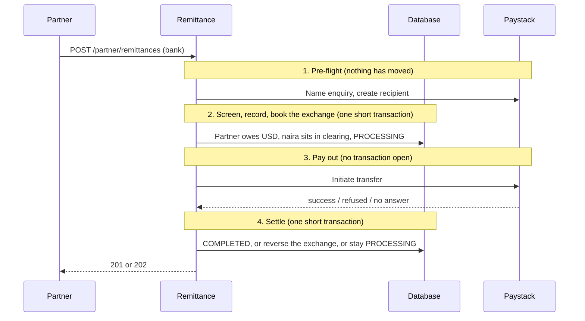
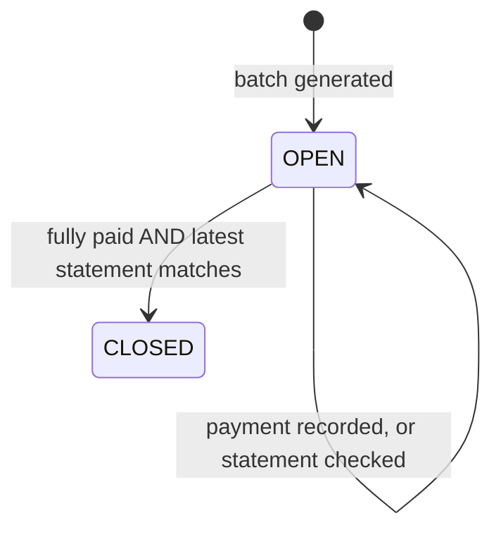

# PayBridge

A Spring Boot **modular monolith** that simulates core banking and cross-border remittance:

- **Customers** hold naira accounts, move money between them, and send money to any Nigerian bank account through the **Paystack** sandbox.
- **Partners** (money-transfer businesses abroad) get exchange-rate quotes, send USD-to-NGN remittances that are paid out in naira, and **settle** what they owe in batches that are reconciled line by line.

Everything sits on a **double-entry ledger** and runs in **sandbox mode**. No real money moves.

It is a learning project, built one module at a time, with the goal of understanding how real payment systems behave: atomicity, idempotency, concurrency, provider failures, reversals and reconciliation.

| | |
|---|---|
| **Live demo** | https://paybridge-xssx.onrender.com |
| **Swagger UI** | https://paybridge-xssx.onrender.com/swagger-ui/index.html |
| **Health check** | https://paybridge-xssx.onrender.com/actuator/health |
| **Instructor demo script** | [docs/INSTRUCTOR_GUIDE.md](docs/INSTRUCTOR_GUIDE.md) |

> **First visit is slow.** The demo runs on a free tier that sleeps after about 15 minutes without traffic. The first request after a sleep can take one to three minutes while the application starts. Open the health-check link first, wait for `{"status":"UP"}`, then use Swagger.

---

## Contents

1. [Two journeys](#two-journeys)
2. [Quick start: the customer journey](#quick-start-the-customer-journey)
3. [Quick start: the partner journey](#quick-start-the-partner-journey)
4. [Things worth trying](#things-worth-trying)
5. [API reference at a glance](#api-reference-at-a-glance)
6. [Error format and codes](#error-format-and-codes)
7. [How it works](#how-it-works)
8. [Run it locally](#run-it-locally)
9. [Configuration](#configuration)
10. [Deployment](#deployment)
11. [Sandbox notes and limitations](#sandbox-notes-and-limitations)
12. [Project structure](#project-structure)
13. [Troubleshooting](#troubleshooting)

---

## Two journeys

PayBridge has two kinds of API caller. Each has its own kind of key, and a key can only open its own doors.

| | **Customer** | **Partner** |
|---|---|---|
| Who | An individual with accounts | A business abroad that collects USD from senders |
| Registers with | `POST /api/v1/customers/register` | `POST /api/v1/partner/register` (sandbox only) |
| Key prefix | `pbk_` | `pbp_` |
| Can use | `/api/v1/customers`, `/accounts`, `/transfers`, `/banks`, `/sandbox` | `/api/v1/partner/**` only |
| Wrong door | `403 FORBIDDEN` | `403 FORBIDDEN` |

Both send their key in the `X-API-Key` header. In Swagger, click **Authorize** and paste it.

---

## Quick start: the customer journey

Open Swagger UI. Each step names the endpoint, the JSON to send, and what you should see.

**1. Register and get your key.** `POST /api/v1/customers/register`

```json
{ "fullName": "Ada Lovelace", "email": "ada@example.com" }
```

Expect `201`. Copy the `apiKey` (starts with `pbk_`). It is shown **once**: the server stores only a hash. Click **Authorize** (top right), paste it, then **Close**. Check with `GET /api/v1/customers/me`.

**2. Open two accounts.** `POST /api/v1/accounts`, twice:

```json
{ "currency": "NGN" }
```

Expect `201` with a 10-digit `accountNumber`. Note both numbers: **A** and **B**. You never send a customer id: the server knows who you are from your key.

**3. Add test money to A.** `POST /api/v1/sandbox/fund`, with header `Idempotency-Key: fund-001`:

```json
{ "accountNumber": "ACCOUNT_A", "amount": 5000.00 }
```

Expect `200` and a balance of `"5000.00"`.

**4. Transfer A to B.** `POST /api/v1/transfers`, header `Idempotency-Key: trf-001`:

```json
{
  "sourceAccountNumber": "ACCOUNT_A",
  "destinationAccountNumber": "ACCOUNT_B",
  "amount": 2000.00,
  "narration": "Rent contribution"
}
```

Expect `201` and `COMPLETED`. `GET /api/v1/accounts` shows A at `3000.00` and B at `2000.00`.

**5. Pay a bank account via Paystack.** `POST /api/v1/transfers/external`, header `Idempotency-Key: ext-001`:

```json
{
  "sourceAccountNumber": "ACCOUNT_A",
  "destinationAccountNumber": "0123456789",
  "destinationBankCode": "001",
  "amount": 500.00,
  "narration": "Invoice 1042"
}
```

Use bank code **`001`** (Paystack's test bank) with any 10-digit account number. Expect `201` and `COMPLETED`, or `202` and `PROCESSING`. For a `PROCESSING` transfer, call `POST /api/v1/transfers/{id}/refresh`. The system also checks automatically every minute.

---

## Quick start: the partner journey

A partner abroad collects USD from a sender, and PayBridge pays the recipient in naira. You will play both the partner and the recipient.

**1. Make a recipient.** As a customer (above), open an NGN account and note its number. Then **Authorize → Logout**.

**2. Register as a partner.** `POST /api/v1/partner/register`:

```json
{ "name": "Acme Remit Ltd", "contactEmail": "ops@acmeremit.example" }
```

Expect `201`. Copy the `apiKey` (starts with `pbp_`), shown once, and **Authorize** with it. The response also shows your `creditLimitUsd` (`10000.00`) and your USD position account. `GET /api/v1/partner/me` shows how much you currently owe.

**3. See the rate.** `GET /api/v1/partner/fx/rate?from=USD&to=NGN` shows the mid-market rate, our spread, and the rate your sender would get. It is **indicative**: only a quote guarantees a rate.

**4. Lock a quote.** `POST /api/v1/partner/fx/quotes`:

```json
{ "sendAmount": 100.00, "sendCurrency": "USD", "receiveCurrency": "NGN" }
```

Expect `201`. The quote shows the fee, the rate, the exact naira the recipient will receive, and `expiresAt` (two minutes). Copy the `quoteId`.

**5. Send the remittance.** `POST /api/v1/partner/remittances`, header `Idempotency-Key: rem-001`:

```json
{
  "quoteId": "PASTE_QUOTE_ID",
  "senderName": "John Smith",
  "senderCountry": "GB",
  "recipientAccountNumber": "THE_CUSTOMER_ACCOUNT_NUMBER",
  "partnerReference": "INV-1"
}
```

Expect `201` and `COMPLETED`. The recipient has the naira, and `GET /partner/me` now shows you owe the send amount. To pay a **bank** instead, add `"recipientBankCode": "001"`: you get `202 PROCESSING` or `201 COMPLETED`.

**6. Settle.** `POST /api/v1/partner/settlements` bundles your completed remittances into a batch. `GET /api/v1/partner/settlements/{id}` shows the **statement**, with every line.

**7. Pay and reconcile.** `POST /api/v1/partner/settlements/{id}/payments` (header `Idempotency-Key: pay-001`) records your USD wire:

```json
{ "amount": 100.00, "wireReference": "WIRE-1" }
```

Then `POST /api/v1/partner/settlements/{id}/reconciliation` with **your own statement**:

```json
{ "lines": [ { "reference": "INV-1", "amount": 100.00 } ] }
```

If it matches ours exactly and the batch is fully paid, it becomes `CLOSED`. Try a wrong amount first to see a **break**.

The full demo script, with failure scenarios, is in [docs/INSTRUCTOR_GUIDE.md](docs/INSTRUCTOR_GUIDE.md).

---

## Things worth trying

| Try this | You should see | What it demonstrates |
|---|---|---|
| Resend the same request with the same `Idempotency-Key` | `200`, `"replayed": true`, nothing moves twice | **Idempotency** |
| Reuse a key with a different body | `409 IDEMPOTENCY_CONFLICT` | A key is bound to one request |
| Transfer more than the balance | `422 INSUFFICIENT_FUNDS` | The balance check happens under a row lock |
| Use another customer's account number | `404 ACCOUNT_NOT_FOUND` | **Ownership checks**; numbers cannot be probed |
| Use a customer key on a partner endpoint | `403 FORBIDDEN` | **Roles** |
| Redeem a quote after two minutes | `422 QUOTE_EXPIRED` | **Rate locking with an expiry** |
| Redeem a quote twice | `409 QUOTE_ALREADY_USED` | A quote is single-use, under a lock |
| Send a remittance with sender name `Ivan Sanctionov` | `422 COMPLIANCE_REJECTED`, "This payment cannot be processed." | **Screening, and not tipping off** |
| Send `Ivan Sanctonov` (one letter off) | `422 COMPLIANCE_REFERRED` | Fuzzy matching: possible match, for an analyst |
| Send two $2,000 remittances from the same sender | The second is rejected, citing a daily limit | **Limits** |
| Send five $2,000 remittances, then a sixth | `422 CREDIT_LIMIT_EXCEEDED`; the quote stays usable | **Credit limit** (the partner is post-funded) |
| Pay a settlement in full but submit a wrong statement | Stays `OPEN`, with the breaks listed | **Reconciliation** |
| Pay more than is outstanding | `422 OVERPAYMENT_NOT_ALLOWED` | Settlement rules |
| More than ~20 money-moving requests in a minute | `429 RATE_LIMITED` | **Rate limiting** |

---

## API reference at a glance

All endpoints are under `/api/v1`. The full, interactive reference is in Swagger UI, where tags are ordered customer first, then partner.

### Customer endpoints (key prefix `pbk_`)

| Method and path | Purpose |
|---|---|
| `POST /customers/register` | Create a customer and receive a key (public) |
| `GET /customers/me` | Who am I? |
| `POST /accounts` · `GET /accounts` · `GET /accounts/{number}` | Open, list and read your accounts |
| `POST /sandbox/fund` | Add test money to one of your NGN accounts |
| `POST /transfers` | Transfer to any PayBridge account |
| `POST /transfers/external` | Send to a Nigerian bank account via Paystack |
| `GET /transfers/{id}` · `POST /transfers/{id}/refresh` | Read a transfer, or ask the provider about a `PROCESSING` one |
| `GET /banks?name=` · `GET /banks/resolve` | Bank list and name enquiry |

### Partner endpoints (key prefix `pbp_`)

| Method and path | Purpose |
|---|---|
| `POST /partner/register` | Sandbox only: create a partner and receive a key (public) |
| `GET /partner/me` | Your credit limit, what you owe, and your available credit |
| `GET /partner/fx/rate` | Indicative rate and spread |
| `POST /partner/fx/quotes` · `GET /partner/fx/quotes/{id}` | Lock a rate; read a quote's status (`ACTIVE`, `USED`, `EXPIRED`) |
| `POST /partner/remittances` | Redeem a quote and deliver naira (account or bank) |
| `GET /partner/remittances` · `GET /partner/remittances/{id}` | Recent remittances, one remittance |
| `POST /partner/remittances/{id}/refresh` | Ask the provider about a `PROCESSING` bank payout |
| `POST /partner/settlements` | Batch your completed, unsettled remittances |
| `GET /partner/settlements` · `GET /partner/settlements/{id}` | Your batches; one batch with every line |
| `POST /partner/settlements/{id}/payments` | Sandbox only: record a USD payment |
| `POST /partner/settlements/{id}/reconciliation` | Submit your statement and compare |

`POST /webhooks/paystack` receives Paystack's signed events. It is hidden from Swagger.

**Simulated payout provider.** 
Paystack's sandbox always succeeds, and a Starter Business account cannot pay real
recipients, so this demo can run with a built-in provider instead (`PAYBRIDGE_PROVIDER_MODE=simulated`). The Paystack
adapter is unchanged and is the default. The simulated provider decides the outcome from the last two digits of the
recipient's account number, so every situation can be triggered on demand:

| Account ends in | Outcome |
|---|---|
| anything else | Paid at once |
| `11` | Refused: the exchange is **reversed** and the partner's credit restored |
| `22` | Times out and was **not** processed: stays `PROCESSING`, then reversed |
| `33` | Times out but **was** paid: stays `PROCESSING`, then `COMPLETED` (no reversal) |
| `44` | Pending, succeeds after about 30 seconds (settled by the reconciliation job or by **refresh**) |
| `55` | Pending, fails after about 30 seconds, then reversed |
| `99` | Beneficiary resolves to a watch-list name: `COMPLIANCE_REJECTED` |

Use any bank code from `GET /api/v1/banks` (for example `058`).

### Conventions

- **Request amounts** are decimals with at most two places (`1500.50`). **Response amounts** come as exact strings (`"1500.50"`), and transfers also include `amountMinor` (kobo), so no client parses a float.
- **`Idempotency-Key`**: 1 to 80 characters, private to each caller.
- **HTTP status describes the request, not the payment.** `202 Accepted` means "received, still in progress". The `status` field in the body is the real state.
- **Partner endpoints never reveal PayBridge's margin or why a compliance check failed.**

---

## Error format and codes

Errors use the standard **Problem Details** format (RFC 9457) with a stable machine-readable `code`:

```json
{ "title": "INSUFFICIENT_FUNDS", "status": 422, "detail": "Account 4017203596 has insufficient funds", "code": "INSUFFICIENT_FUNDS" }
```

| Code | HTTP | Meaning |
|---|---|---|
| `UNAUTHENTICATED` | 401 | Missing or invalid `X-API-Key` |
| `FORBIDDEN` | 403 | The key is valid but not allowed on this endpoint |
| `ACCOUNT_NOT_FOUND`, `TRANSFER_NOT_FOUND`, `QUOTE_NOT_FOUND`, `REMITTANCE_NOT_FOUND`, `SETTLEMENT_NOT_FOUND`, `PARTNER_NOT_FOUND`, `PARTNER_ACCOUNT_NOT_FOUND` | 404 | Not found, **or not yours** (deliberately indistinguishable) |
| `IDEMPOTENCY_CONFLICT` | 409 | The key was already used for a different request |
| `EMAIL_ALREADY_REGISTERED`, `PARTNER_ALREADY_REGISTERED`, `DUPLICATE_PARTNER_REFERENCE` | 409 | Already exists |
| `QUOTE_ALREADY_USED` | 409 | The quote was already redeemed |
| `DATA_CONFLICT` | 409 | A concurrent identical request won the race. Retry. |
| `INSUFFICIENT_FUNDS` | 422 | The debit would overdraw the account |
| `CREDIT_LIMIT_EXCEEDED` | 422 | The remittance would take the partner past its credit limit |
| `INVALID_AMOUNT`, `AMOUNT_OUT_OF_RANGE`, `AMOUNT_TOO_SMALL` | 422 | Bad, too small, or outside the allowed range |
| `QUOTE_EXPIRED` | 422 | Request a new quote |
| `UNSUPPORTED_CORRIDOR`, `UNSUPPORTED_CURRENCY`, `CURRENCY_MISMATCH` | 422 | Only USD to NGN, and NGN accounts for these actions |
| `SAME_ACCOUNT_TRANSFER`, `ACCOUNT_NOT_ELIGIBLE`, `RECIPIENT_NOT_ELIGIBLE`, `ACCOUNT_NOT_ACTIVE`, `ACCOUNT_LIMIT_REACHED` | 422 | Account rules |
| `COMPLIANCE_REJECTED`, `COMPLIANCE_REFERRED` | 422 | A compliance check stopped the payment. The message is deliberately vague for watch-list hits. |
| `NOTHING_TO_SETTLE`, `SETTLEMENT_CLOSED`, `OVERPAYMENT_NOT_ALLOWED` | 422 | Settlement rules |
| `INVALID_STATE_TRANSITION`, `INVALID_IDEMPOTENCY_KEY` | 422 | Internal state or key rules |
| `PROVIDER_REJECTED` | 422 | Paystack refused the request. Nothing was sent. |
| `RATE_LIMITED` | 429 | Too many requests. See `Retry-After`. |
| `PROVIDER_UNAVAILABLE`, `PROVIDER_NOT_CONFIGURED`, `RATE_UNAVAILABLE` | 503 | A dependency did not give a reliable answer |

**Rate limits** (per caller, or per address when not logged in): money-moving `POST`s 20 per minute; bank list and name enquiry 20 per minute; everything else 120 per minute; registration 5 per hour per address.

---

## How it works

### Modules

A single deployable application split into modules with strict boundaries. **A module may only use another module through its `api/` package.**

| Module | Responsibility |
|---|---|
| `shared` | `Money`, errors, idempotency keys, API-key security contract, configuration |
| `customer` | Registration, API-key authentication (Spring Security), roles |
| `partner` | Partner onboarding, API keys, credit limit |
| `account` | Customer, system and partner-position accounts; locked credit and debit |
| `ledger` | Append-only double-entry postings, sandbox funding |
| `transfer` | Customer transfers, the Paystack adapter, payouts, webhooks, reconciliation |
| `fx` | Rates, spread, fee, expiring single-use quotes, booking and reversing exchanges |
| `compliance` | Name screening, daily limits, audit of refusals |
| `remittance` | The partner remittance workflow, to a PayBridge account or a bank |
| `settlement` | Batches, partner payments, statement reconciliation |
| `notification` | Scaffolded only |

Dependencies point one way: `remittance` uses `fx`, `compliance`, `account` and `transfer` (through its payout capability); `fx` uses `ledger` and `account`; `settlement` listens to events from `remittance`. Where one module must learn about another's events (webhooks, completions), the lower-level module defines an interface or event and the higher-level one implements or publishes it, so there are no cycles.

### Money is never a floating-point number

Amounts are whole **minor units** (`long`) with a currency. Overflow uses `Math.addExact`. Exchange rates are `BigDecimal` with an explicit scale, and **everything rounds down in one place** (`FxMath`): sub-kobo remainders stay with PayBridge.

### Double-entry ledger

Every movement is a posting of two or more entries that balance **within one currency**: total debits equal total credits. A `CREDIT` increases an account and a `DEBIT` decreases it. Ledger rows are append-only (Java, Hibernate and a database trigger all refuse changes), and each posting has a unique reference, which makes retries safe. **Each currency's balances sum to zero.**

System accounts (fixed account numbers):

| Number | Account | Purpose |
|---|---|---|
| `0000000001` | Sandbox funding (NGN) | Where test money "comes from" |
| `0000000002` | Paystack clearing (NGN) | Naira committed to the payment provider |
| `0000000003` / `0000000004` | FX position USD / NGN | PayBridge's exposure after exchanges |
| `0000000005` / `0000000006` | Fee revenue USD / FX revenue NGN | What PayBridge earns |
| `0000000007` | Nostro USD | PayBridge's USD bank account, where partner payments arrive |

### An exchange is two postings

Because a posting balances in a single currency, a $100 remittance books two, tied together by a **correlation id**:

| USD posting | Debit | Credit |
|---|---|---|
| | Partner's USD position (the partner now owes $100) | FX Position USD ($99) and Fee Revenue USD ($1) |

| NGN posting | Debit | Credit |
|---|---|---|
| | FX Position NGN (value at the mid rate) | Recipient or Paystack clearing (the payout) and FX Revenue NGN (the spread) |

A failed bank payout is undone by posting the **mirror image** of both, at the quote's locked amounts, never at today's rate.

### Quotes, rate locking and rounding

A quote shows the mid rate, a spread (default 150 basis points), a flat fee and the exact naira received, valid for two minutes and **usable once**. Redeeming it takes a row lock inside the same transaction that books the money, so a race produces one winner. The rate feed here is a deterministic simulation (a triangle wave of plus or minus 1% around 1,500 over an hour). A live feed would be a second implementation of `RateProvider`.

### Remittance to a bank: four phases

No database transaction is ever held open while waiting on the network.



**A timeout is not a failure.** If Paystack does not answer, the payout may or may not have happened, so nothing is reversed. The remittance stays `PROCESSING` until the provider is asked:

| What Paystack says | Result |
|---|---|
| Found, success | `COMPLETED`. No reversal: the money did go out. |
| Found, failed or reversed | The exchange is **reversed** and the partner's credit restored |
| No record, after a grace period | Reversed: the request never arrived |
| Pending | Stays `PROCESSING` |

Three independent things can settle a `PROCESSING` item: the original response, a **signed webhook**, and a **reconciliation job** that runs every minute. The row is locked and a settled item ignores later updates, so nothing is reversed twice. Webhooks are routed by reference prefix (`trf_` for customer transfers, `rem_` for remittances) through a handler interface, so the transfer module never depends on the remittance module.

### Compliance

Before any money moves, a remittance is screened:

- **Sanctions-style name matching** of the sender (and the beneficiary for bank payouts): names are normalised (case, accents, punctuation, word order) and compared exactly or by edit distance. An exact hit is **rejected**, a close one is **referred** to an analyst, and very short names are never fuzzy-matched.
- **Daily limits** per sender, per recipient and per partner, over a rolling 24 hours.
- **A blocked-country list** (illustrative).

Watch-list hits return only "This payment cannot be processed.": telling someone they are flagged would **tip them off**. Limit checks are check-then-act, so concurrent payments sharing a sender, recipient or partner queue on a Postgres **advisory lock**. An approval joins the payment's transaction; a **refusal is recorded in its own transaction** and survives the payment's rollback. The audit table is append-only. The lists and limits are a simulation, not legal advice.

### Settlement and reconciliation

When a remittance completes, an **event** is published inside its transaction and the settlement module records a *settlement item* in the same commit (the outbox pattern), so a completed remittance can never go unsettled. A unique constraint makes each remittance part of at most one batch.



A **payment** is a ledger posting (debit the USD nostro, credit the partner's position), which restores the partner's credit. **Reconciliation** compares the partner's statement with ours by reference and reports **breaks**: `MISSING_FROM_STATEMENT`, `UNEXPECTED_IN_STATEMENT`, `AMOUNT_MISMATCH`, `DUPLICATE_IN_STATEMENT`. Every check is stored permanently. A batch closes only when it is fully paid **and** reconciled: the database enforces this with a `CHECK` constraint. Money is not the same as agreement.

### Concurrency

Balances change under **pessimistic row locks**, always in a fixed order so opposing transfers cannot deadlock. The test suite fires real races against a real database: overdrafts, quote redemption, credit limits, limit checks, duplicate keys and simultaneous batch requests.

### Security model

- API keys are 256 bits of randomness, shown once, stored only as a SHA-256 hash, with a prefix per caller type.
- Authorisation by role, and ownership checked on every object. Other people's objects return `404`.
- Idempotency keys are scoped to the caller.
- Rate limiting, stateless sessions, no cookies, no stack traces in responses.
- A **live** Paystack key (`sk_live_`) makes the application refuse to start.

---

## Run it locally

### Prerequisites

Java 21 or later (the exact version is `java.version` in `pom.xml`), Maven, Docker Desktop, and a free [Paystack](https://paystack.com) account in **Test mode** for a test secret key (`sk_test_...`).

### Steps

**1. Clone**

```bash
git clone https://github.com/YOUR_USERNAME/paybridge.git
cd paybridge
```

**2. Create `.env`** next to `docker-compose.yml` (git-ignored):

```
POSTGRES_DB=paybridge
POSTGRES_USER=paybridge
POSTGRES_PASSWORD=change_me_locally
```

Keep that password, or set the same `POSTGRES_PASSWORD` in the shell you run the app from. The database keeps the password it was **first created with**.

**3. Start PostgreSQL** (host port **5433**)

```bash
docker compose up -d
```

**4. Set your Paystack key** in the terminal you will run the app from.

PowerShell: `$env:PAYSTACK_SECRET_KEY = "sk_test_your_key_here"`
Bash: `export PAYSTACK_SECRET_KEY="sk_test_your_key_here"`

The app starts without it, but bank list, name enquiry and bank payouts return `503 PROVIDER_NOT_CONFIGURED`.

**5. Run**

```bash
mvn spring-boot:run
```

Flyway builds the schema on first start. Open http://localhost:8080/swagger-ui/index.html.

### Tests

Create the separate test database once, so tests never touch your demo data:

```bash
docker exec -it paybridge-db psql -U paybridge -c "CREATE DATABASE paybridge_test;"
mvn test
```

The suite covers: money and rounding rules, ledger balancing, FX maths and the simulated feed, name matching, reconciliation, rate limiting, signature checking, and integration tests for **concurrency, idempotency, every provider failure path** (using a fake gateway: success, rejection, timeout, timeout-but-actually-paid, pending), webhooks, the reconciliation jobs, compliance, remittances, settlement, and **authentication and ownership over real HTTP**. The Paystack API itself is never called.

### Checking the books

Each should return no rows, and the last should return `0` for every currency:

```sql
-- 1. Every ledger transaction balances
SELECT transaction_id FROM ledger_entry GROUP BY transaction_id
HAVING SUM(CASE direction WHEN 'CREDIT' THEN amount_minor ELSE -amount_minor END) <> 0;

-- 2. Each account's balance equals the sum of its ledger entries
SELECT a.account_number, a.balance_minor, COALESCE(e.total, 0) AS ledger_total
FROM account a
LEFT JOIN (
    SELECT account_id, SUM(CASE direction WHEN 'CREDIT' THEN amount_minor ELSE -amount_minor END) AS total
    FROM ledger_entry GROUP BY account_id
) e ON e.account_id = a.id
WHERE a.balance_minor <> COALESCE(e.total, 0);

-- 3. Every currency nets to zero on its own
SELECT currency, SUM(balance_minor) FROM account GROUP BY currency;
```

---

## Configuration

### Environment variables

| Variable | Purpose | Default |
|---|---|---|
| `PAYSTACK_SECRET_KEY`, `PAYBRIDGE_PROVIDER_MODE`                             | Paystack **test** secret key. Live keys are refused. | empty, simulated      |
| `PAYSTACK_SANDBOX_RECIPIENT_CODE` | A pre-created Paystack recipient (`RCP_...`) reused for the test bank `001` | empty |
| `SPRING_DATASOURCE_URL` / `_USERNAME` / `_PASSWORD` | Database connection | local Docker database |
| `DB_POOL_SIZE` | Maximum database connections | `5` |
| `PORT` | HTTP port (hosting platforms set this) | `8080` |

Any property below can be overridden by an environment variable (for example `PAYBRIDGE_SANDBOX_FUNDING_ENABLED=false`).

### Application settings (`application.yml`)

| Property | Purpose | Default |
|---|---|---|
| `paybridge.sandbox.funding-enabled` | Customer test funding | `true` |
| `paybridge.sandbox.partner-registration-enabled` | Open partner sign-up | `true` |
| `paybridge.sandbox.settlement-payments-enabled` | Simulated partner payments | `true` |
| `paybridge.rate-limit.enabled` | Rate limiting | `true` |
| `paybridge.partners.default-credit-limit-usd` | Credit limit for a new partner | `10000.00` |
| `paybridge.fx.spread-bps` · `fee-usd` · `quote-ttl` | Our margin, flat fee, quote lifetime | `150` · `1.00` · `PT2M` |
| `paybridge.fx.min-send-usd` · `max-send-usd` | Quote amount range | `5.00` · `2000.00` |
| `paybridge.fx.simulated-base-rate` · `fixed-mid-rate` | Centre of the simulated market; freeze it | `1500.00` · unset |
| `paybridge.compliance.sender-daily-limit-usd` · `recipient-` · `partner-` | Rolling 24-hour limits | `3000.00` · `5000.00` · `50000.00` |
| `paybridge.compliance.blocked-names` · `blocked-countries` · `match-threshold` | The simulated watch list | two fictional names · `KP` · `0.85` |
| `paybridge.transfers.provider-grace` | How long a payout must be `PROCESSING` before "provider has no record" allows a reversal | `2m` |
| `paybridge.transfers.reconcile-enabled` · `reconcile-interval` · `reconcile-min-age` | The stuck-payout job (transfers and remittances) | `true` · `PT1M` · `PT30S` |
| `paybridge.settlement.min-age` | Minimum age of a completed remittance before it can be batched | `PT0S` |

---

## Deployment

The live demo runs on free tiers:

- **App:** [Render](https://render.com) as a Docker web service, built from this repository's `Dockerfile` (two-stage build, non-root runtime, memory-conscious JVM flags: about 240 MiB at idle).
- **Database:** [Neon](https://neon.com) PostgreSQL. Use the **direct** connection, not the pooled one: Flyway relies on advisory locks.

| Render setting | Value |
|---|---|
| Language | Docker |
| Health check path | `/actuator/health` |
| Environment variables | `SPRING_DATASOURCE_URL` (`jdbc:postgresql://HOST/DBNAME?sslmode=require`), `SPRING_DATASOURCE_USERNAME`, `SPRING_DATASOURCE_PASSWORD`, `PAYSTACK_SECRET_KEY`, `PAYSTACK_SANDBOX_RECIPIENT_CODE`, `PAYBRIDGE_PROVIDER_MODE : simulated` |

Render redeploys on every push to `main`, and Flyway applies any new migrations on startup. In the Paystack dashboard (Test mode, **Settings → API Keys & Webhooks**), set the test webhook URL to `https://YOUR-SERVICE.onrender.com/api/v1/webhooks/paystack`.

To run the container yourself:

```bash
docker build -t paybridge .
docker run --rm -p 8081:8080 --memory=512m \
  -e SPRING_DATASOURCE_URL="jdbc:postgresql://host.docker.internal:5433/paybridge" \
  -e SPRING_DATASOURCE_USERNAME=paybridge -e SPRING_DATASOURCE_PASSWORD=change_me_locally \
  -e PAYSTACK_SECRET_KEY="$PAYSTACK_SECRET_KEY" paybridge
```

---

## Sandbox notes and limitations

**Paystack test mode**

- Transfers are **simulated** and always succeed, so failure paths are proven by the automated tests with a fake provider, not by the live demo.
- Name enquiry on **real** bank accounts is capped at three per day for the whole test key. Use bank code **`001`**, which resolves any 10-digit number to `TEST ACCOUNT <number>`.
- Creating a Paystack recipient needs a real account, so for `001` the adapter reuses one pre-created recipient (`PAYSTACK_SANDBOX_RECIPIENT_CODE`). The payout is still a real Paystack API call and appears in the dashboard with a reference beginning `trf_` (customer transfers) or `rem_` (remittances).

**Simplifications**

- Exchange rates are simulated, and only the USD to NGN corridor exists.
- Remittances to PayBridge accounts are final immediately. Only bank payouts can be reversed.
- Partner payments are simulated by an endpoint standing in for PayBridge finance matching an incoming wire. Real settlement involves bank statements, value dates, cut-off times and netting.
- The watch list, limits and country list are illustrative, and nothing here is legal or regulatory advice.
- A referred (possible-match) payment is simply refused: there is no analyst review queue.
- Paystack gateway for remittances is simulated

**Known limitations**

- No email verification or KYC: anyone can register, and sandbox funding and partner sign-up are open (and rate limited).
- Rate-limit counters live in memory (one instance). Several instances would need a shared store.
- Account-name lookups are not cached.
- API keys cannot be rotated or revoked through the API.
- System accounts such as FX position are updated by every exchange, which makes them **hot accounts**. At scale they would be sharded.
- Remittances completed before the settlement module existed are not in any batch.
- The `notification` module is scaffolding only.

---

## Project structure

```
src/main/java/com/academy/paybridge
├── shared/        Money, errors, idempotency keys, API-key security contract, config
├── customer/      registration, API-key security, roles, rate limiting
├── partner/       partner onboarding and keys
├── account/       accounts, balances, locked credit and debit
├── ledger/        double-entry postings, sandbox funding
├── transfer/      customer transfers, Paystack adapter, payouts, webhooks, reconciliation
├── fx/            rates, quotes, booking and reversing exchanges
├── compliance/    screening, limits, audit trail
├── remittance/    partner remittances, bank payouts, reconciliation
├── settlement/    batches, payments, statement reconciliation
└── notification/  scaffolded

src/main/resources/db/migration/   Flyway migrations V1 to V15
src/test/                          unit, integration and HTTP-level tests
Dockerfile · docker-compose.yml    container build; local PostgreSQL
docs/INSTRUCTOR_GUIDE.md           copy-paste demo script
```

**Stack:** Java, Spring Boot 4.1, Spring Security, Spring Data JPA (Hibernate), Flyway, PostgreSQL 17, springdoc-openapi (Swagger UI), Log4j2, Docker.

The `TransferGateway` interface hides the payment provider behind a small contract, so another provider (Monnify, Flutterwave) could be added as a second implementation without touching the business logic.

---

## Troubleshooting

| Symptom | Likely cause and fix |
|---|---|
| The page hangs on first load | The free-tier instance is waking up. Wait up to three minutes and open `/actuator/health` first. |
| `401 UNAUTHENTICATED` | Click **Authorize** and paste your key, with no stray spaces. If you lost it, register again with a different email or name. |
| `403 FORBIDDEN` | You are using a customer key on a partner endpoint, or the reverse. **Authorize → Logout**, then authorize with the right key. |
| `404` for something you can see | You are authorized as a different caller than the one who owns it. |
| `422 QUOTE_EXPIRED` | Quotes last two minutes. Create a new one. |
| `422 PROVIDER_REJECTED` on a bank payout | Paystack refused it, and nothing moved. Use bank code `001`. |
| `503 PROVIDER_UNAVAILABLE` mentioning a daily limit | The sandbox quota for real bank lookups is used up. Use bank code `001`. |
| `429 RATE_LIMITED` | Wait for the seconds in `Retry-After`. |
| `PARTNER_ACCOUNT_NOT_FOUND` | The partner was registered before position accounts existed. Register a new one. |
| Local startup: `password authentication failed` | The database was created with a different password. Set the user's password to match, or recreate the Docker volume. |
| Local startup: `database "paybridge_test" does not exist` | Create it with the command in [Tests](#tests). |
| Docker build: `release version N not supported` | The Java version in `pom.xml` must exist in the `Dockerfile`'s build image. |
